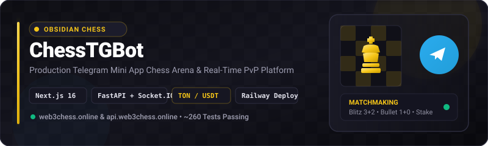
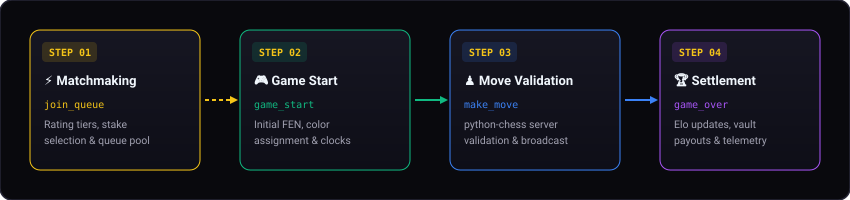
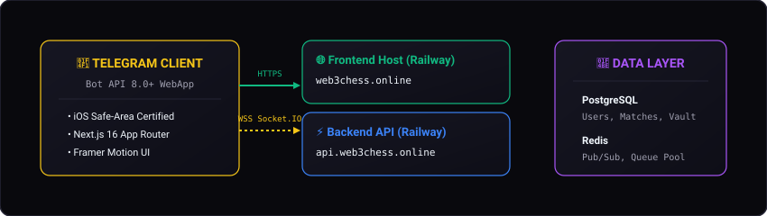
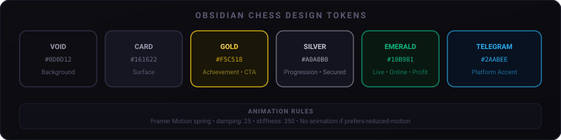

<p align="center">
  
</p>

<p align="center">
  <a href="https://web3chess.online"></a>
  <a href="https://api.web3chess.online"></a>
  
  
  
</p>

---

## ♟️ Overview & Value Proposition

**ChessTGBot** is a production-grade Telegram Mini App chess platform engineered for competitive PvP matchmaking, real-time gameplay, and game telemetry inside Telegram.

### Development north star: Pareto principle

We aim to find the roughly 20% of engineering effort that delivers 80–100% of useful product impact. For each change, name the player or operator outcome, identify its main bottleneck, choose the smallest high-impact solution, and verify it with a focused test or observable product signal. Reuse the design system and existing services before adding new infrastructure. The ratio guides prioritization; it is not a promise of results or permission to skip security, money correctness, accessibility, reliability, or required CI checks. Reassess the backlog using measured outcomes after release.

Built on a **Next.js 16 (App Router)** client and a **FastAPI + Socket.IO** real-time server, the application delivers the **Obsidian Chess** experience—a dark, high-contrast, tactile UI optimized for Telegram mobile viewports and iOS safe-area insets.

```text
Audience: Telegram Mini App players seeking Web3 competitive chess & developers building production Telegram WebApps.
One-Sentence Value: Real-time Telegram Mini App chess arena with high-stakes PvP, TON/USDT vault, and Obsidian Chess UI.
Primary Proof: Dual Railway production services, ~600 backend integration tests, static-export CI guard, and Bot API 8.0+ fullscreen compliance.
First Action: Launch the app in Telegram or run `docker-compose up -d && pytest` locally.
```

---

## 🔄 Real-Time Game Loop & State Machine

The core match lifecycle is managed through Socket.IO WebSocket connections and backed by `python-chess` move validation on the server:

<p align="center">
  
</p>

### Socket.IO Event Lifecycle

| Event Name | Direction | Payload Description |
| --- | --- | --- |
| `join_queue` | Client → Server | Rating tier, time control (e.g. 3+2, 1+0), optional wager stake. |
| `game_start` | Server → Client | Opponent profile, match UUID, initial FEN, white/black color assignment. |
| `make_move` | Client → Server | UCI move string (e.g. `e2e4`), client clock timestamp, move nonce. |
| `move_made` | Server → Client | Updated FEN, last move highlight, remaining clock time for both players. |
| `draw_offer` / `draw_respond` | Bidirectional | Interactive draw offer modal with accept/decline nonces. |
| `game_over` | Server → Client | Termination reason (checkmate, timeout, resignation, draw), rating update, XP payout. |

---

## 📐 Production Topology & Host Routing

The application operates across **three separate Railway services** auto-deployed on push to `main`:

<p align="center">
  
</p>

### Service Endpoint Reference

| Component | Production Domain | Railway Internal Host | Tech Stack |
| --- | --- | --- | --- |
| **Marketing website** | [`web3chess.online`](https://web3chess.online) | Railway website service | Next.js 16 (App Router), `website/` |
| **Mini App and desktop web** | [`app.web3chess.online`](https://app.web3chess.online) | Railway frontend service | Next.js 16 (App Router), `frontend/` |
| **Backend API** | [`api.web3chess.online`](https://api.web3chess.online) | [`chesstgbot-backend-production.up.railway.app`](https://chesstgbot-backend-production.up.railway.app) | FastAPI, Socket.IO, SQLAlchemy, Redis |

> [!CAUTION]
> The single-container monolith host (`chesstgbot-production.up.railway.app`) is **DEAD / INACTIVE**. Do not test against or send traffic to it. Runtime routing in [`frontend/src/lib/api.ts`](frontend/src/lib/api.ts) maps the app and website domains directly to `api.web3chess.online`.

---

## 🎨 Obsidian Chess Design System

Visual presentation follows [`BRAND_DESIGN_SYSTEM.md`](BRAND_DESIGN_SYSTEM.md). Obsidian Chess prioritizes dark obsidian surfaces, Gold achievement accents, and tactical board grid motifs:

<p align="center">
  
</p>

### Design System Rules

- **Default Theme**: Obsidian Chess (`#0D0D12` void, `#161622` card background).
- **Gold Accent (`#F5C518`)**: Reserved exclusively for achievements, primary CTA buttons, rating ranks, and active match stakes.
- **Silver Status (`#A0A0B0`)**: Used for progression milestones, secondary action buttons, and secured UI states.
- **Micro-Animations**: Framer Motion transitions with spring physics (`damping: 25`, `stiffness: 350`).
- **Tactile Grid**: 36px radial dot grids and subtle chess board rank/file keylines.

---

## 📱 Hard-Won Engineering Conventions

### 1. iOS Telegram WebApp Fullscreen Safe-Area
- In fullscreen mode (`tg.requestFullscreen()`, Bot API 8.0+), iOS Telegram defines `--tg-content-safe-area-inset-bottom: 0px`. Standard CSS `var()` fallback chains short-circuit at `0px` and ignore `env(safe-area-inset-bottom)`.
- **Rule**: Bottom insets **MUST** combine with `max()`, exposed via `--app-safe-bottom` in [`frontend/src/app/globals.css`](frontend/src/app/globals.css).
- **Navigation Safety**: The bottom navigation bar is **never** conditionally hidden on main dashboard pages (`shouldHideNavbar` in `frontend/src/components/LayoutWrapper.tsx`). Overlays use `z-index >= 100`.

### 2. Money & Bot Security Rules
- **HTML Escaping**: All user-controlled strings (especially Telegram display names) **MUST** be HTML-escaped before entering `parse_mode="HTML"` bot messages to prevent entity parsing crashes.
- **Withdrawals**: Payouts below auto-review threshold remain as `pending_confirmation` until confirmed via HMAC nonce in Telegram bot chat ([`backend/app/services/withdrawal_confirmation.py`](backend/app/services/withdrawal_confirmation.py)).
- **Admin Alert Routing**: System errors log via `app.bot.errors` and map to named systems (`GAME CLIENT`, `CORE API`, `TREASURY`, `REALTIME`, `SECURITY`) in [`backend/app/core/alerts.py`](backend/app/core/alerts.py).

### 3. Static Export Guard (`static-export-fresh`)
- CI runs `bash scripts/check-static-export-fresh.sh` on every pull request. Modifying `frontend/src` without updating `backend/static_frontend` fails the build.
- Rebuild static bundle locally after frontend changes:
  ```bash
  cd frontend && npm run build:static
  ```

---

## 🚀 Quickstart & Developer Workflow

### Prerequisites
- Node.js 20+ & npm 10+
- Python 3.11+
- Docker & Docker Compose

### 1. Start Local Infrastructure (Postgres + Redis)
```bash
git clone https://github.com/VladislavBrodsky/ChessTGBot.git
cd ChessTGBot

# Spin up Postgres and Redis containers
docker-compose up -d
```

### 2. Launch FastAPI Backend

For a fresh checkout, copy `backend/.env.example` to `backend/.env` if the file does not exist. Generate two independent values for `SECRET_KEY` and `WEBHOOK_SECRET` using the command in the example. The file is for local development; Railway production uses the service variables described below.

```bash
python3 -m venv .venv
source .venv/bin/activate

pip install --require-hashes -r backend/requirements.txt
cd backend
uvicorn app.main:app --reload --port 8000
```

### 3. Launch Next.js Frontend
```bash
cd frontend
npm ci
npm run dev
```

Visit `http://localhost:3000` to play locally.

### Reproducible dependency updates

Both Next.js apps commit `package-lock.json`. Use `npm ci --include=optional` in
development, CI, and Docker; it selects the current platform's binaries from the
same locked dependency tree. Use `npm install` only when intentionally updating
dependencies, and commit the changed manifest and lock together. Generate locks
with npm 10.8.2 (the Node 20 deployment toolchain), and verify `npm ci` with that
version before committing; npm 11 can omit optional entries that npm 10 requires. The website's
Lighthouse tool is also locked, rather than downloaded by `npx` during CI.

Python direct dependencies live in `backend/requirements.in`; the generated
`requirements.txt` pins the complete tree with hashes. Audit tooling has a separate
input and lock. The manual content QA workflow uses its own small hashed lock at
`marketing/content-ops/requirements.txt`. Regenerate from the repository root with uv 0.10.11:

```bash
uv pip compile --universal --python-version 3.12 --generate-hashes backend/requirements.in -o backend/requirements.txt
uv pip compile --universal --python-version 3.12 --generate-hashes backend/requirements-audit.in -o backend/requirements-audit.txt
uv pip compile --universal --python-version 3.12 --generate-hashes marketing/content-ops/requirements.in -o marketing/content-ops/requirements.txt
```

CI and Docker install these files with `pip install --require-hashes`. Test changed
locks on Linux CI before deploying. Enable Railway's **Wait for CI** on the Website,
Frontend, and Backend services so a failed workflow cannot trigger a deployment.

### Production environment variables

Each Railway service has its own variables. The references below document every application setting consumed by the current source, including optional controls and legacy aliases. They contain source defaults and blank credential fields; they are not exports of the live services.

| Process | Variable reference | Values to obtain from the owning account |
| --- | --- | --- |
| Backend API (`api.web3chess.online`) | [`backend/.env.production.example`](backend/.env.production.example) | Postgres/Redis references, chess bot token, admin IDs, signing/webhook secrets, verified wallet/provider configuration and existing money policy |
| Mini App (`app.web3chess.online`) | [`frontend/.env.production.example`](frontend/.env.production.example) | Optional public Sentry DSN; API URL and bot username are provided |
| Website (`web3chess.online`) | [`website/.env.production.example`](website/.env.production.example) | Optional Google site verification; domain and Telegram links are provided |
| Marketing publisher (`@chess_hub`) | [`marketing/.env.production.example`](marketing/.env.production.example) | Dedicated marketing bot token; channel is provided |

Compare these references against the existing service variables before adding missing entries. Preserve live credentials, wallet addresses, limits and feature flags. Use Railway references to the actual Postgres and Redis service names for `DATABASE_URL` and `REDIS_URL`; private connection strings are not usable from a local machine. Railway injects `PORT` and deployment metadata automatically. [Railway variable documentation](https://docs.railway.com/variables).

The Mini App and website public variables are fixed during `next build`. Their Dockerfiles declare the required build arguments, as [Railway requires for Docker builds](https://docs.railway.com/builds/dockerfiles). Rebuild after changing these values. Keep private tokens and wallet secrets in the backend or publishing process. The production example files are not automatically loaded by the backend and do not change Railway variables.

The `NEXT_PUBLIC_TRANSAK_*` and `NEXT_PUBLIC_SELF_CUSTODY_BRIDGE_ENABLED` entries in the current local frontend file are unused by the current source and are not production requirements. `OPENAI_API_KEY` is used only by manual academy generation scripts; `ANTHROPIC_API_KEY` is optional for the separate marketing writer.

---

## 🧪 Verification & Testing

| Suite | Command | Coverage / Scope |
| --- | --- | --- |
| **Backend Integration** | `cd backend && python -m pytest` | ~600 pytest cases testing DB models, game state, Redis pub/sub, and auth |
| **Frontend Unit Tests** | `cd frontend && npm test` | 14 Jest suites (59 tests) covering navbar context, modals, SWR hooks, and game UI |
| **Static Export Guard** | `bash scripts/check-static-export-fresh.sh` | CI freshness guard comparing `frontend/src` changes against `backend/static_frontend` |

---

## 📁 Repository Map

```text
ChessTGBot/
├── assets/readme/           # Project-native SVG visual assets (hero, architecture, game-loop, brand)
├── backend/                 # FastAPI + Socket.IO application
│   ├── app/                 # Core engine, bot handlers, database models, services
│   ├── static_frontend/     # Committed static export (monolith deployment fallback)
│   └── tests/               # Pytest suite (~600 tests)
├── frontend/                # Next.js 16 App Router application
│   ├── src/app/             # Pages, internationalized routes, globals.css
│   ├── src/components/      # Obsidian Chess UI primitives & game boards
│   └── src/lib/             # Socket.IO client, API fetcher, Telegram SDK wrappers
├── scripts/                 # Maintenance scripts (check-static-export-fresh.sh)
├── AGENTS.md                # Engineering conventions & production rules
├── BRAND_DESIGN_SYSTEM.md   # Authoritative Obsidian Chess visual specification
└── docker-compose.yml       # Local Postgres & Redis configuration
```

---

## 📜 License

Distributed under the [MIT License](LICENSE).
